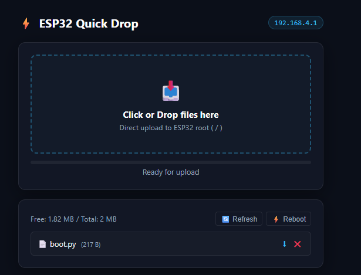
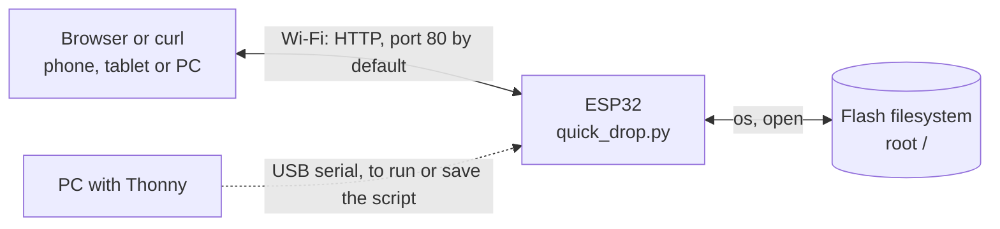
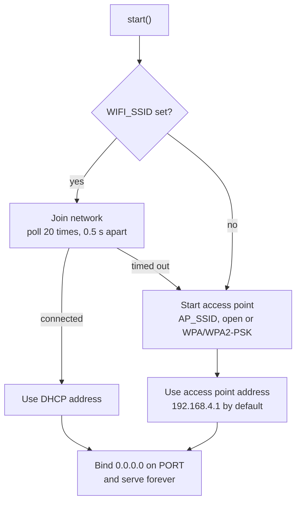
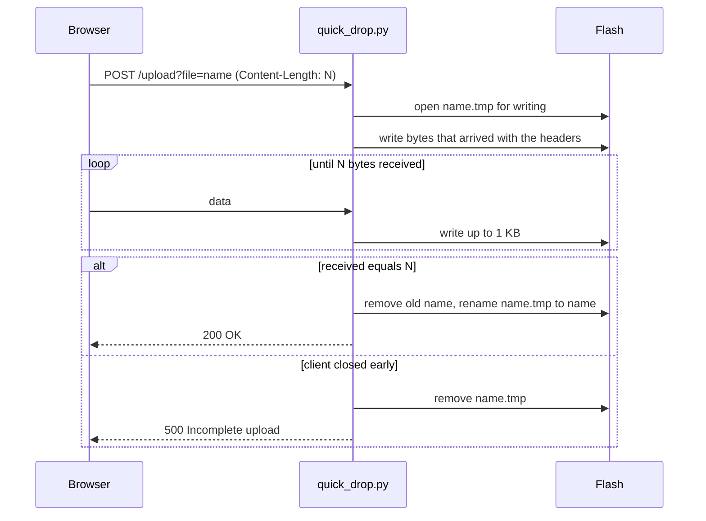

<div align="center">

# ESP32 Quick Drop

**A single MicroPython file that turns an ESP32 into a wireless file receiver: drag files onto a web page and they land on the board's flash, no USB cable needed.**

[](https://micropython.org/)
[](https://www.espressif.com/en/products/socs/esp32)
[](LICENSE)

[Report a Bug](https://github.com/sumitrawat2417/esp32-quick-drop/issues) · [Request a Feature](https://github.com/sumitrawat2417/esp32-quick-drop/issues)

<br/><br/>



</div>

---

## Overview

**ESP32 Quick Drop** is a single-file MicroPython tool that lets you push files to an ESP32's root filesystem from any browser, for makers, students, and developers who iterate on board code without wanting to keep a USB cable attached.

**The problem:** Copying a script or an asset onto a MicroPython board normally means a USB cable and a desktop tool, which gets awkward once the board is mounted, in an enclosure, or running from a power bank. Fuller web file managers exist (including this author's [ESP32 File Hub](https://github.com/sumitrawat2417/esp32-file-hub)), but they are multi-file packages, which is more than you need for dropping one or two files.

**The approach:** Everything lives in one file, `quick_drop.py` (about 16 KB), which uses only modules built into MicroPython. The file contains the Wi-Fi setup, a small socket-based HTTP server, and the web page itself (about 7 KB of HTML, CSS, and JavaScript held in a Python string). Run it from Thonny, or save it to the board as `main.py` to start on power-up. The board then creates its own Wi-Fi network, or joins yours, and serves a drag-and-drop page. Uploads are streamed to flash through a temporary file using a fixed 1 KB buffer, so memory use does not depend on file size.

## Features

- **Single file, no dependencies:** `quick_drop.py` imports only `socket`, `network`, `os`, `gc`, and `time` at startup (`json` and `machine` are imported on demand). Nothing to install on the board.
- **Drag and drop or click to choose:** Select several files at once. They upload one after another, each to the root directory (`/`).
- **Streamed, staged uploads:** Data is received in 1 KB chunks and written to `<name>.tmp`. The temporary file replaces the target only when the received byte count equals the declared `Content-Length`; if the client disconnects partway, the temporary file is removed and the original file is untouched.
- **Two Wi-Fi modes:** If `WIFI_SSID` is set, the board tries to join that network for about 10 seconds, then falls back to its own access point (`QuickDrop-ESP32`, open unless you set a password of 8 or more characters).
- **File list with sizes:** Shows the regular files in `/` sorted by name, with sizes, plus free and total flash space from `os.statvfs`.
- **Download, delete, and reboot:** Download any root file, delete files (with a confirmation prompt), or reset the board with the Reboot button (also confirmed).
- **Scriptable HTTP API:** The same endpoints the page uses work from `curl` or any HTTP client (see [REST API](#rest-api)).
- **Works offline:** The page contains no external scripts, fonts, or stylesheets, so it needs no internet access.

## Tech Stack

| Layer | Technology | Notes |
| --- | --- | --- |
| Firmware runtime | MicroPython (tested on v1.20+) | Built-in modules only: `socket`, `network`, `os`, `gc`, `time`, plus `json` and `machine` on demand |
| Network | Raw TCP sockets, HTTP/1.1 | Hand-written request parser, `Connection: close` on every response |
| Web interface | HTML5, CSS3, vanilla JavaScript | Embedded as a Python string in `quick_drop.py`, dark theme, single column |
| Storage | MicroPython filesystem (`os`, `open`) | Root directory only; `os.statvfs` for capacity |
| Development | [Thonny](https://thonny.org/) (recommended) | Used to run the script and save it to the board |

## Hardware Overview

Quick Drop runs on an ESP32 development board with MicroPython installed. It needs no external components and configures no GPIO pins. The board talks to browsers over 2.4 GHz Wi-Fi, and USB is only needed to load the script.



### Bill of Materials

| Qty | Component | Model | Purpose | Notes |
| ---: | --- | --- | --- | --- |
| 1 | ESP32 development board | ESP32-WROOM (tested) | Runs MicroPython and Quick Drop | Must already have MicroPython firmware installed |
| 1 | USB cable | Micro-USB or USB-C, to match the board | Loading the script | Must carry data, not charge only |
| 1 | USB power source | Charger or power bank (optional) | Standalone operation after `main.py` is saved | Powered over 5 V USB, per the maintainer |

## Architecture

`start()` brings up Wi-Fi once, then enters an endless loop that accepts one connection at a time, parses the request, runs the matching route, and calls `gc.collect()`.



An upload follows this path:



The server is single-threaded and blocking: it finishes one request before it accepts the next, and each connection has a 10-second socket timeout. The request headers must fit in 4,096 bytes.

## Getting Started

### Prerequisites

- An ESP32 development board with [MicroPython firmware](https://micropython.org/download/) installed (tested on an ESP32-WROOM with v1.20 or later)
- A USB data cable
- [Thonny](https://thonny.org/) on your computer (any tool that can run a script on the board and save a file to it also works)
- Git, or simply download `quick_drop.py` from this repository

### Install and run

```bash
git clone https://github.com/sumitrawat2417/esp32-quick-drop.git
cd esp32-quick-drop
```

1. Connect the ESP32 to your computer over USB.
2. Open Thonny and select **MicroPython (ESP32)** as the interpreter (bottom-right corner).
3. Open `quick_drop.py`. To join your own Wi-Fi instead of creating a hotspot, first set `WIFI_SSID` and `WIFI_PASS` (see [Configuration](#configuration)).
4. Press **Run current script** (F5).

F5 runs the script on the board. To keep it there, follow [Start on every boot](#start-on-every-boot).

### Verify it works

In access point mode (the default), the Thonny shell prints:

```text
[QuickDrop] Standalone Access Point active!
   SSID : QuickDrop-ESP32
   IP   : 192.168.4.1

==================================================
  ESP32 Quick Drop is ready!
  Open in browser: http://192.168.4.1/
==================================================
```

Join the `QuickDrop-ESP32` Wi-Fi network (open by default) and browse to `http://192.168.4.1/`. Use `http://`, not `https://`. You should see the drop zone and the list of files on the board, with a free-space line above it.

In station mode, the shell shows `[QuickDrop] Connecting to 'YourNetwork'...` followed by `[QuickDrop] Connected! IP: <address>`, and the ready banner prints that address. Open it from any device on the same network.

### Start on every boot

To run Quick Drop whenever the board powers up, save the script to the board as `main.py`: in Thonny choose **File, Save as..., MicroPython device**, and name it `main.py`. Then unplug USB and power the board from any USB supply.

> [!WARNING]
> `start()` never returns, so Quick Drop cannot run alongside your own program. If Quick Drop is the board's `main.py` and you upload a different `main.py` through it, the upload replaces Quick Drop itself. After the next reboot the board runs your code and the wireless page is gone, until you run `quick_drop.py` again over USB. Plan for this: either leave Quick Drop as `main.py` and upload files under other names, or accept that uploading a `main.py` hands the board over to your code.

### Configuration

All settings are variables at the top of `quick_drop.py`:

| Variable | Default | Description |
| --- | --- | --- |
| `WIFI_SSID` | `""` | Network to join in station mode. Leave empty to go straight to access point mode |
| `WIFI_PASS` | `""` | Password for that network |
| `AP_SSID` | `"QuickDrop-ESP32"` | Name of the access point |
| `AP_PASS` | `""` | Access point password. Used only when it has 8 or more characters (WPA/WPA2-PSK); anything shorter, including empty, leaves the network open |
| `PORT` | `80` | TCP port for the HTTP server |

Two things to know. If you change `PORT`, the startup banner still prints the address without a port, so add `:<port>` yourself. And anything you type into `WIFI_PASS` is stored in plain text in the script, so do not commit it.

### Troubleshooting

| Symptom | Likely cause and fix |
| --- | --- |
| The page does not load on a phone | Phones may route traffic over mobile data when a Wi-Fi network has no internet. Turn mobile data off, or choose to stay connected when the phone warns about no internet |
| "Connection refused" or an SSL error | Use `http://`, not `https://`. Quick Drop does not speak TLS |
| The server stops answering for about 10 seconds | A client opened a request and went quiet. The server waits up to 10 seconds before it moves on |
| A file named `something.tmp` appears in the list | An earlier upload timed out or hit a write error. Delete it from the list |
| Wireless access disappeared after an upload | You probably replaced `main.py`. See the warning under [Start on every boot](#start-on-every-boot) |

## Usage

### Browser

1. Open the board's address (`http://192.168.4.1/` in access point mode, or the IP printed in station mode).
2. Drop one or more files on the dashed area, or click it to choose files.
3. Watch the status line and progress bar. The bar jumps to 30% when a file starts and to 100% when it finishes; it does not track bytes.
4. Use the download arrow or the delete cross beside a file. Deleting asks for confirmation. Use Refresh to reload the list.
5. Click Reboot (and confirm) to reset the board, for example after uploading new code.

### curl

```bash
# List files and storage (free_mb, total_mb, files)
curl http://192.168.4.1/api/list

# Upload (curl sets Content-Length itself; do not add the header by hand)
curl -X POST --data-binary @notes.txt "http://192.168.4.1/upload?file=notes.txt"

# Download
curl -o notes.txt "http://192.168.4.1/download?file=notes.txt"

# Delete
curl -X POST "http://192.168.4.1/delete?file=notes.txt"

# Reset the board
curl -X POST http://192.168.4.1/reboot
```

> [!IMPORTANT]
> Do not pass `-H "Content-Length: ..."` with a made-up number. The server trusts that header. A value smaller than the file saves a silently truncated copy and still answers `200 OK`; a value larger than the file makes the server wait out its 10-second timeout and leaves a `.tmp` file behind.

### REST API

Every response closes the connection. There is no authentication.

| Method | Endpoint | Parameters | Response |
| --- | --- | --- | --- |
| `GET` | `/` or `/index.html` | none | `200` with the web page |
| `GET` | `/api/list` | none | `200` JSON: `{"free_mb": 1.56, "total_mb": 2.0, "files": [{"name": "main.py", "size": 1254}]}`. Regular files in `/` only; names starting with `.` are hidden |
| `POST` | `/upload` | `file` (target name, default `uploaded.bin`), body is the raw bytes, `Content-Length` required | `200` `OK` on success. `400` `Invalid parameters` if `Content-Length` is missing or zero (chunked bodies are not supported) or the name is empty. `500` `Incomplete upload` if the client closed early. Other failures close the connection without a response |
| `GET` | `/download` | `file` | `200` with the file, `Content-Disposition: attachment` and `Content-Length`. `404` `File not found` |
| `POST` | `/delete` | `file` | `200` `Deleted`. `500` `Delete failed`, which also covers a file that does not exist |
| `POST` | `/reboot` | none | `200` `Rebooting`, then `machine.reset()` after one second |

Any other request returns `404`.

## Status and Known Limitations

**Status:** Version 1.0.0, a single initial release (the version appears in the commit message; the script itself carries no version string). The behavior described here was checked against the source.

- **Tested on:** An ESP32-WROOM board with MicroPython v1.20 or later, as reported by the maintainer. Other ESP32 variants (S2, S3, C3) and other MicroPython ports (ESP8266, RP2040 Pico W) have not been tested.
- **No authentication and no encryption:** Anyone who can reach the board over Wi-Fi can list, download, overwrite, and delete any file in `/`, including `boot.py` and `main.py`. If you saved `quick_drop.py` as `main.py` with your `WIFI_PASS` filled in, that password can be downloaded too. The access point is open unless you set `AP_PASS`, and traffic is plain HTTP.
- **Root directory only in the interface:** The page lists only files in `/`; folders and dot-files are hidden and there is no way to create a folder. The `file` parameter is appended to `/` as given, after removing leading slashes, with no other validation. A name such as `lib/x.py` is written into `/lib` if that folder already exists, and an upload into a missing folder drops the connection. Use [ESP32 File Hub](https://github.com/sumitrawat2417/esp32-file-hub) if you need nested folders, breadcrumb navigation, and an inline file viewer.
- **Unusual file names break:** The server decodes only `+` and `%20` (both as spaces) in the `file` parameter. Names with other special characters are saved in percent-encoded form (for example `café.txt` becomes `caf%C3%A9.txt`, and `a+b.txt` becomes `a%2Bb.txt`), and the page can then neither download nor delete them. Rename files to letters, digits, spaces, `-`, `_`, `.`, `(`, and `)` before uploading.
- **One request at a time:** A stalled client holds up every other request for up to 10 seconds.
- **Staging is not fully atomic:** The replacement step removes the old file and then renames the temporary one. A power cut between those two calls could leave neither. If an upload stalls or a write fails, the original file stays intact but `<name>.tmp` remains and shows up in the list.
- **No free-space check:** The server writes without checking free flash space first, so an upload larger than the free space fails partway.
- **2.4 GHz Wi-Fi only,** because that is all the ESP32 radio supports.
- **No automated tests:** The only check is `python -m py_compile quick_drop.py`.

## Challenges and Lessons

- **Challenge:** Boards running MicroPython have very little free RAM, so an HTTP server that buffers a whole request body is limited by RAM rather than by flash.
  **What I did:** The server reads the headers in 512-byte pieces (up to 4,096 bytes), then streams the body to flash in 1 KB reads, so the buffer stays the same size whether the file is 2 bytes or 2 MB. The trade-off is that the server handles one connection at a time.
- **Challenge:** A browser tab closed or a Wi-Fi drop in the middle of an upload would leave a half-written `main.py` that fails on the next boot.
  **What I did:** Uploads go to `<name>.tmp` and replace the target only if the byte count matches `Content-Length`. The limit of this approach is that the swap is two steps (remove, then rename), and a timeout can still leave a `.tmp` file behind.
- **Challenge:** Keeping the whole tool in one file means the web page is a Python string.
  **What I did:** The page is a 6,850-byte string constant that avoids external assets, so there is nothing else to copy to the board. The cost is that the HTML is encoded again on every page load and is harder to edit than a separate `.html` file.

## Contributing

Bug reports, ideas, and pull requests are welcome. Please open an [issue](https://github.com/sumitrawat2417/esp32-quick-drop/issues) before starting larger changes. The project keeps to a few rules:

1. Keep the runtime in one file. Do not add helper `.py`, `.js`, or `.css` files to the core.
2. Use only modules that ship with standard MicroPython firmware. No external packages.
3. Keep comments short and informative, so the file stays readable in Thonny.
4. Check syntax before testing on a board:

   ```bash
   python -m py_compile quick_drop.py
   ```

   This catches syntax errors only. Test behavior on a real board.

## License

This project is licensed under the [MIT License](LICENSE).

## Acknowledgements

- [MicroPython](https://micropython.org/): the runtime this project is written for.
- [Thonny](https://thonny.org/): the recommended editor for running the script and saving it to the board.

---

<div align="center">

If this saved you time, a star helps others find it.

**Designed and developed by [Forbit](https://github.com/sumitrawat2417) (Sumit Rawat)**

[Report a Bug](https://github.com/sumitrawat2417/esp32-quick-drop/issues) · [Request a Feature](https://github.com/sumitrawat2417/esp32-quick-drop/issues)

<sub>ESP32 is a trademark of Espressif Systems (Shanghai) Co., Ltd. This project is not affiliated with, endorsed by, or connected to Espressif.</sub>

</div>
