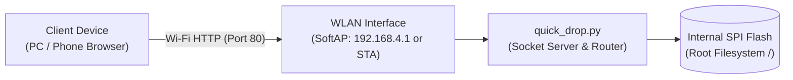

<div align="center">

# ESP32 Quick Drop

**Single-file wireless file uploader for MicroPython boards over Wi-Fi.**

[](LICENSE)

[Report a Bug](https://github.com/sumitrawat2417/esp32-quick-drop/issues) · [Request a Feature](https://github.com/sumitrawat2417/esp32-quick-drop/issues)

</div>

---

## Overview

ESP32 Quick Drop is an ultra-lightweight, zero-dependency utility that provides browser-based file transfers directly to the root filesystem of an ESP32 microcontroller running MicroPython.

**The problem:** Uploading code and static assets to an ESP32 typically requires a physical USB cable, desktop IDEs, command-line flashing tools, or complex multi-file web packages that consume substantial flash storage and RAM.

**The approach:** Quick Drop consolidates the entire application—TCP socket server, Wi-Fi driver, REST router, and a responsive web interface—into a single Python script (`quick_drop.py`). It streams incoming uploads directly to flash storage in 1 KB chunks using atomic temporary staging, preventing memory exhaustion on resource-constrained microcontrollers.

---

## Features

- **Single-file architecture:** The entire tool is contained within `quick_drop.py` with zero third-party library dependencies.
- **In-browser drag-and-drop:** Modern web UI served directly from flash memory, enabling file uploads from desktop and mobile browsers.
- **Dual Wi-Fi operation:** Runs as a standalone Access Point (`QuickDrop-ESP32`) by default, with configurable Station mode and automatic Access Point fallback.
- **Chunked streaming I/O:** Buffers network payloads in 1 KB increments, allowing multi-megabyte file uploads without scaling RAM consumption.
- **Atomic file staging:** Writes incoming uploads to `.tmp` files and swaps them on completion, preventing file corruption if a transfer is interrupted.
- **Live storage metrics:** Queries total and available flash memory in real time via `os.statvfs`.
- **Remote board management:** Supports downloading existing files, deleting root files, and triggering software resets (`machine.reset()`) directly from the browser.

---

## Tech Stack

| Layer | Technology | Details |
| :--- | :--- | :--- |
| Firmware Runtime | MicroPython (v1.19+) | Standard standard library modules (`socket`, `network`, `os`, `gc`, `time`, `machine`) |
| Network Transport | Raw TCP Sockets | Non-blocking socket listener on port 80 with manual HTTP header parsing |
| Web Frontend | HTML5, CSS3, Vanilla JS | Embedded self-contained single-page application with responsive dark theme |
| Storage Engine | MicroPython Virtual File System (VFS) | Direct SPI flash streaming and atomic file replacement |

---

## Hardware Overview

ESP32 Quick Drop runs on standard ESP32 microcontrollers and other MicroPython-compatible boards equipped with Wi-Fi.



- **Target MCU:** ESP32 (WROOM, WROVER, S2, S3, C3) or RP2040 Pico W with MicroPython firmware.
- **Storage medium:** Internal SPI flash filesystem (VFS).
- **Network interface:** 2.4 GHz 802.11b/g/n Wi-Fi radio.
- **Power requirements:** Standard 5 V USB supply or 3.3 V regulated rail.

---

## Getting Started

### Prerequisites

- An ESP32 development board flashed with [MicroPython firmware](https://micropython.org/download/).
- A Micro-USB or USB-C data cable.
- [Thonny IDE](https://thonny.org/) or any serial terminal capable of interacting with the MicroPython REPL.

### Quick Run via Thonny

1. Connect your ESP32 to your computer via USB.
2. Open **Thonny IDE** and set the interpreter to **MicroPython (ESP32)** in the bottom-right corner.
3. Open [`quick_drop.py`](quick_drop.py) in Thonny.
4. Press **Run current script (F5)**.
5. The serial terminal will display the startup banner:

   ```text
   [QuickDrop] Standalone Access Point active!
      SSID : QuickDrop-ESP32
      IP   : 192.168.4.1

   ==================================================
     ESP32 Quick Drop is ready!
     Open in browser: http://192.168.4.1/
   ==================================================
   ```

6. Connect your client device (phone, laptop, tablet) to the Wi-Fi network named **`QuickDrop-ESP32`**.
7. Navigate to `http://192.168.4.1` in your web browser.

### Automatic Execution on Boot

To run Quick Drop automatically whenever the microcontroller is powered on:

1. In Thonny, select `File -> Save as...`.
2. Choose **MicroPython device**.
3. Save the file as **`main.py`** in the root directory.
4. Disconnect the USB cable. The board will now start the Quick Drop server on any power source.

---

## Configuration

All configuration options are located at the top of [`quick_drop.py`](quick_drop.py):

| Variable | Default | Description |
| :--- | :--- | :--- |
| `WIFI_SSID` | `""` | Station mode SSID. If empty, the device starts in Standalone Access Point mode. |
| `WIFI_PASS` | `""` | Station mode Wi-Fi password. |
| `AP_SSID` | `"QuickDrop-ESP32"` | SSID broadcasted by the ESP32 in Access Point mode. |
| `AP_PASS` | `""` | Password for the Access Point. Leave empty for an open network, or provide 8+ characters for WPA2-PSK. |
| `PORT` | `80` | TCP port for the HTTP server. |

---

## Usage

### Browser Workflow

1. Open `http://192.168.4.1` (or the local station IP address if configured).
2. Drag one or more files from your computer and drop them into the dashed upload area, or click the box to browse.
3. Observe the progress bar as the file streams to flash storage.
4. Use the **Download** (⬇) or **Delete** (✕) buttons to manage files in the root directory.
5. Click **Reboot** to trigger a software reset and execute newly uploaded `main.py` scripts.

### CLI Automation via cURL

You can also interact with the server directly using command-line tools:

**List files and storage capacity:**
```bash
curl -X GET http://192.168.4.1/api/list
```

**Upload a file:**
```bash
curl -X POST "http://192.168.4.1/upload?file=main.py" \
     -H "Content-Length: 1024" \
     --data-binary "@main.py"
```

**Download a file:**
```bash
curl -O -J "http://192.168.4.1/download?file=main.py"
```

**Delete a file:**
```bash
curl -X POST "http://192.168.4.1/delete?file=temp.txt"
```

**Trigger soft reboot:**
```bash
curl -X POST http://192.168.4.1/reboot
```

---

## Project Structure

```text
esp32-quick-drop/
├── .gitignore       # Git exclusion rules (ignores local caches and docs/)
├── LICENSE          # MIT License terms
├── README.md        # Project documentation
└── quick_drop.py    # Self-contained application runtime (~16 KB)
```

---

## Status and Known Limitations

### Current Status
- Version 1.0.0 initial release. Tested on ESP32-WROOM hardware running MicroPython v1.20+.

### Known Limitations
- **Flat directory scope:** Quick Drop uploads directly to root (`/`). It does not create or navigate nested subdirectories. For full recursive folder trees and an in-browser code editor, see [ESP32 File Hub](https://github.com/sumitrawat2417/esp32-file-hub).
- **Sequential transfers:** The socket server handles one client connection at a time. Multiple simultaneous uploads will queue or timeout.
- **Unencrypted transport:** Operates over plain HTTP without TLS. Use on trusted local networks or in direct Access Point mode.
- **No authentication:** By default, any client connected to the Access Point or local network can read, upload, and delete files.

---

## License

This project is licensed under the [MIT License](LICENSE).

---

<div align="center">

**Designed and developed by [Forbit](https://github.com/sumitrawat2417) (Sumit Rawat)**

[GitHub](https://github.com/sumitrawat2417)

</div>
